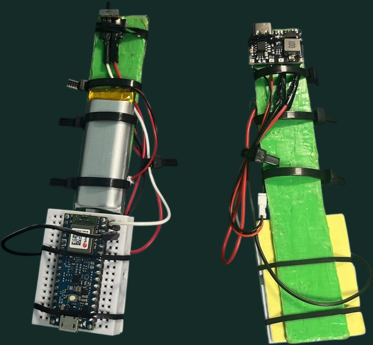

# Carrot Mart · Two-Hand Motion Controllers

**Jinsoo Kim · Controller design and integration · September–December 2025**

I proposed a game in which riding a horse and throwing a lasso would have different physical controls. In our three-person team, I led the game design, built the two handheld controllers and integrated their inputs with Unreal Engine. My teammates worked on gameplay and 3D assets. This repository contains the firmware for my controller work. [Watch the team gameplay demo](https://www.youtube.com/watch?v=5GK0shB4Gpw).

## One input channel for each hand

| Hand | Player action | What the device sends |
| --- | --- | --- |
| [Left · horse controls](firmware/HorseControl_Test02/HorseControl_Test02.ino) | Steer, brake and cue movement | BLE keyboard events. Changes on the X axis trigger `A` or `D`, a Y-axis gesture triggers `Shift`, and a Z-axis gesture triggers a `W` then `S` sequence. |
| [Right · lasso controls](firmware/Lasso_BLE_Mouse_Final01/Lasso_BLE_Mouse_Final01.ino) | Start spinning, sustain the spin and release the lasso | BLE mouse events. Spin starts a right-button hold, sustained rotation generates left clicks, and a detected throw releases the right button. |

## What changed during testing

Early steering tests documented unintended input overlap. The preserved firmware also contains guards against keys remaining held. I changed the left controller to use per-axis changes in acceleration, reject cross-axis motion and explicitly release held keys. The right controller uses a separate idle/spin state machine. It looks for an acceleration peak and a drop in angular speed before signaling a throw.

## Build the two sketches

Each controller uses its own **Arduino Nano 33 BLE Rev2**. Open each `.ino` from the folder of the same name. Select the **Arduino Mbed OS Nano Boards** core and the Nano 33 BLE board target. The source uses [Arduino_BMI270_BMM150](https://github.com/arduino-libraries/Arduino_BMI270_BMM150) for the IMU and [Mbed BLE HID](https://github.com/tcoppex/mbed-ble-hid) for keyboard and mouse reports.

Flash the left and right sketches to separate boards and pair **Rein BLE Keyboard** and **Lasso BLE Mouse** with the host. Each sketch writes diagnostic events at 115200 baud. To inspect the inputs without the game, use a key or mouse event viewer. The gameplay demo shows how the original Unreal project interprets those events.

Both sketches build for `arduino:mbed_nano:nano33ble` with Mbed OS Nano Boards **4.6.0**, Arduino_BMI270_BMM150 **1.2.3** and Mbed BLE HID **1.3.0**.

## Scope

Prepared from the preserved project firmware. The two sketches are included; the team’s Unreal game and third-party game assets are not redistributed here. Compilation checks are distinct from integrated hardware tests.
