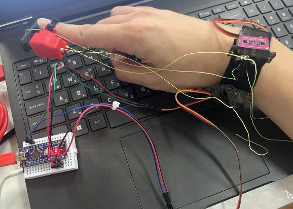
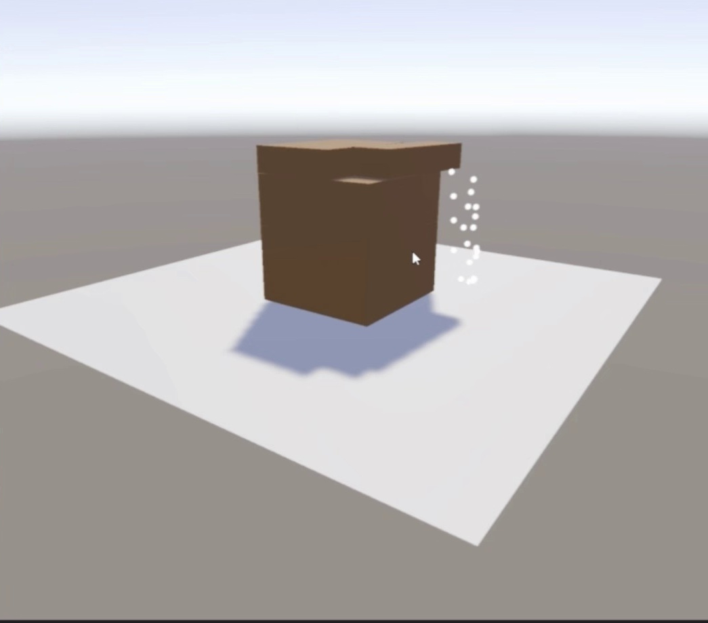
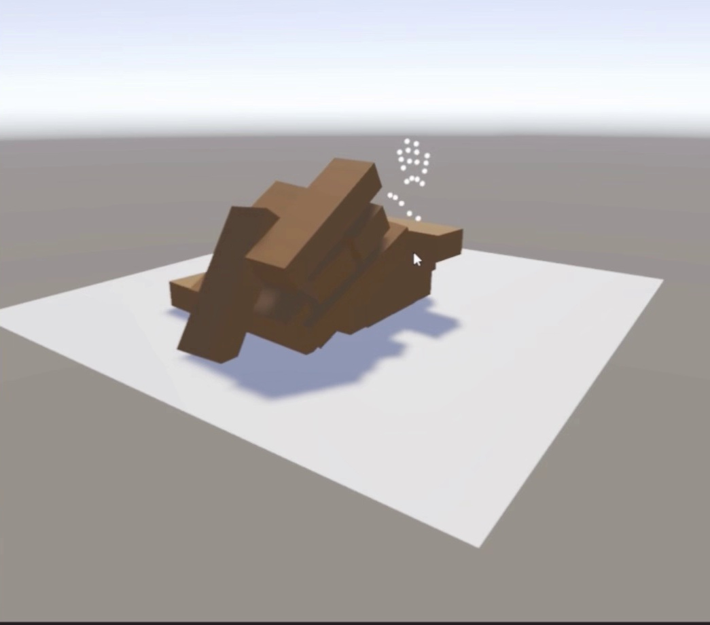

# PGI (Player-Game Interaction) Feedback System

**Jinsoo Kim · Individual prototype · March–June 2026**

Two Jenga blocks can look alike but resist a push differently. I used a virtual tower to explore how a game could return a contact cue to the player’s index finger. I designed the wearable mechanism, fabricated three hardware iterations and connected hand tracking, game physics and servo actuation. PGI stands for Player–Game Interaction.

## How it works

1. A webcam tracks 21 hand landmarks. The [Python tracker](tracking/mediapipe_hand.py) filters their positions and streams them to Unity over UDP on port `5005`.
2. The [Unity scene](unity/Assets/Scenes/JengaScene.unity) places the tracked fingertip near the blocks. The [contact component](unity/Assets/Scripts/HandPhysicsCollider.cs) estimates a simulated force from collision impulse. The [haptic controller](unity/Assets/Scripts/HapticController.cs) uses finger orientation, proximity and tracking quality to select servo commands.
3. Two wrist-mounted servos drive the fingertip pad through tendons. One rotates the pad and the other changes tension. An [Arduino Nano Every sketch](firmware/PGI_JengaSimulator/PGI_JengaSimulator.ino) receives two angle bytes over serial at 115200 baud and controls the servos on pins 9 and 10.

I compared two wire-and-spring layouts while revising the mount. The spring, bearing and tendon routing are visible in the [assembly close-up](images/tendon-assembly.jpg).

## Prototype demonstration

| Fingertip approaching the tower · 13.5 s | Blocks displaced · 18.0 s |
| --- | --- |
|  |  |

These frames come from the June 17 demonstration of hand tracking and virtual block interaction. Earlier worn-device footage and the project report document integrated servo response. The preserved control code includes later June 22 revisions; the June 17 recording does not verify those revisions. Turning the hand could interrupt tracking, and I observed lag and servo jitter. Whether players can distinguish block resistance through this device remains an open question.

## Open the prototype

1. Open the `unity/` folder with Unity **6000.4.10f1**. Open `Assets/Scenes/JengaScene.unity`. To preview with a webcam alone, disable **Enable Serial** on the scene’s `SerialController` component.
2. From `tracking/`, install the Python dependencies with `python -m pip install -r requirements.txt`. Download the **Hand Landmarker** model bundle from [Google’s model guide](https://developers.google.com/edge/mediapipe/solutions/vision/hand_landmarker#models) and save it beside the script as `hand_landmarker.task`.
3. Run `python mediapipe_hand.py` from `tracking/` and press Play in Unity. The tracker uses webcam index `0` and sends to `127.0.0.1`. Press `q` in the camera window to stop it.
4. For the physical device, install the **Arduino megaAVR Boards** core and **Servo** library, then flash the sketch to a Nano Every. Set **Port Name** on `SerialController` to the board’s serial port and enable serial output. The sketch starts the servos at 90° and 180°. Check pad direction and tendon travel with the device off the hand before a worn test.

The firmware builds for `arduino:megaavr:nona4809` with core **1.8.8** and Servo **1.2.2**. All seven C# scripts compile against the Unity 6000.4.10f1 editor assemblies. The Python tracker was also checked with the Hand Landmarker model and a single synthetic frame.

## Contribution and scope

Individual project: interaction concept, mechanism design, fabrication, integration requirements and prototype testing by Jinsoo Kim, with AI-assisted software implementation. Completed for major credit through Sangmyung University’s Future Design Program, with support from the Haptics and Virtual Reality Lab at Kyung Hee University.

This is a preserved prototype, not calibrated force rendering. The stored control code checks geometric conditions, not measured pad alignment. Hardware and perceptual performance have not been revalidated during this packaging.
